# AI Education Platform

An English-learning web app for **Sinhala-speaking learners** in Sri Lanka.

- **Save words** and see the Sinhala meaning fill in automatically (local dictionary first, translation API as a cached fallback).
- **Practise vocabulary** with four test types that adapt to what you find hard.
- **Follow a grammar path** from simple to hard (9 lessons) that unlocks as you score well, with Sinhala notes and translated examples.
- **Review your history** and every question you got wrong.

| Dashboard | Words (auto-fill) |
| --- | --- |
| 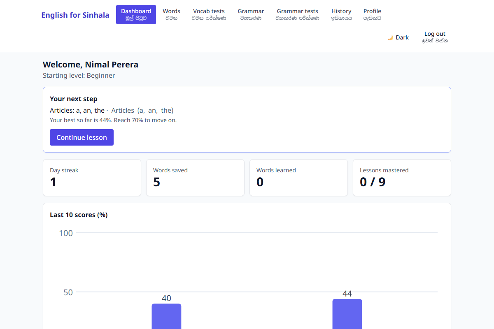 | 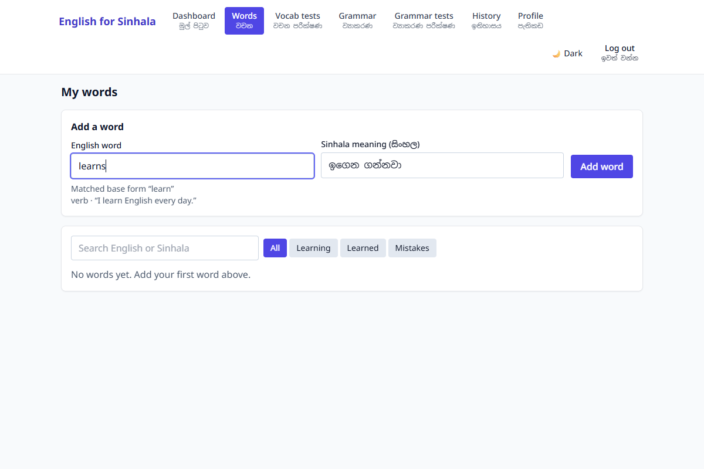 |

| Lesson with Sinhala notes | Instant grammar feedback |
| --- | --- |
| 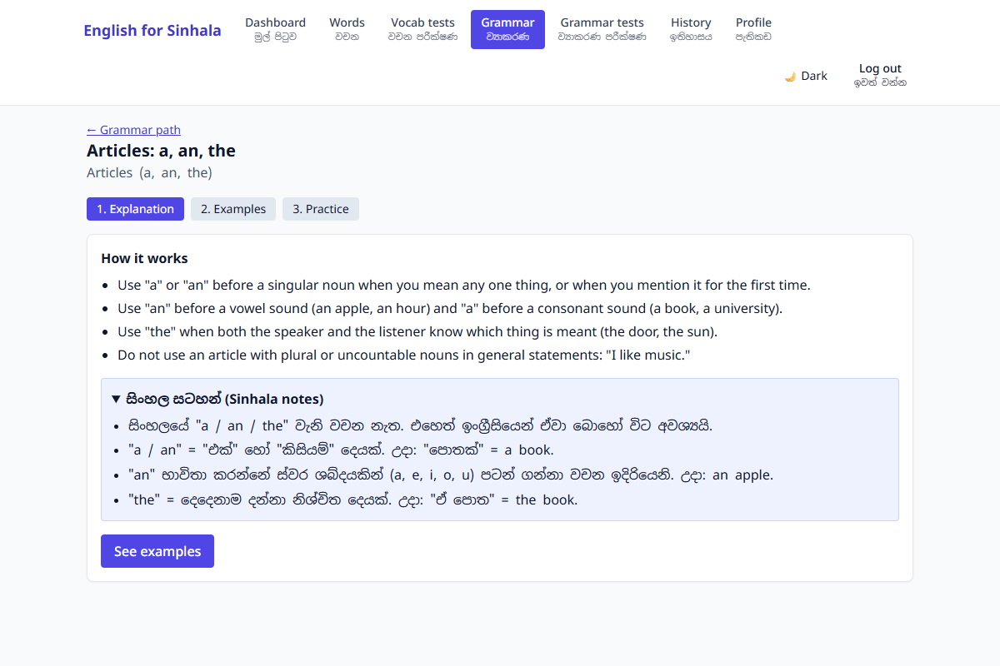 | 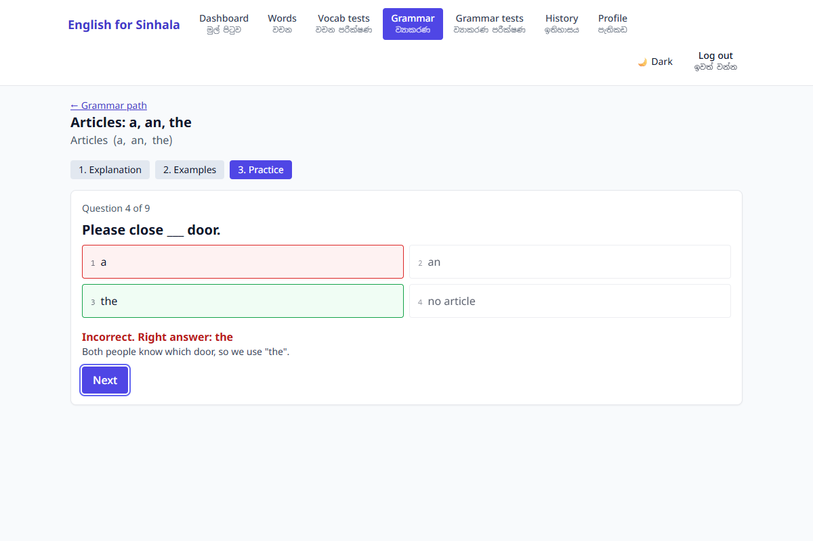 |

| Vocabulary test | History |
| --- | --- |
| 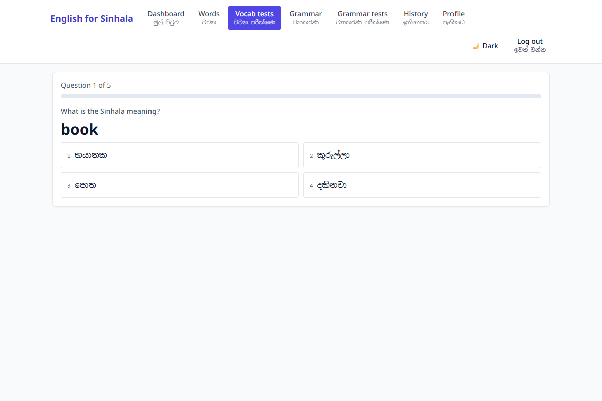 | 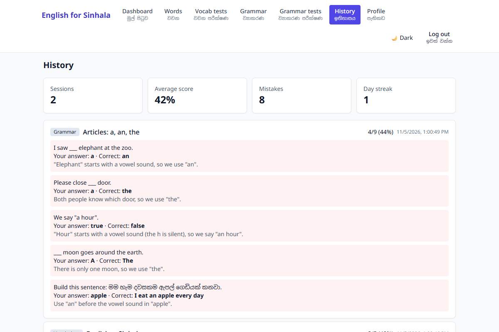 |

| Home hero | Choose your challenge |
| --- | --- |
| 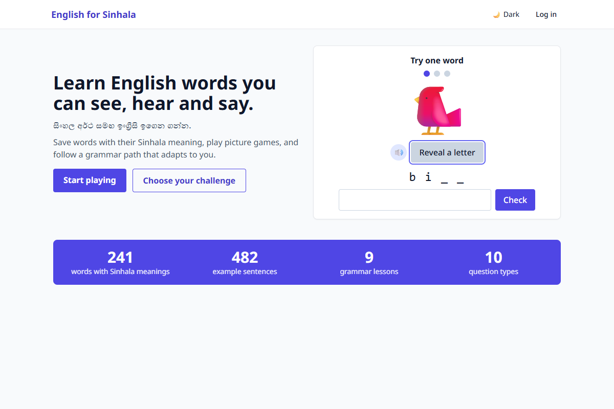 | 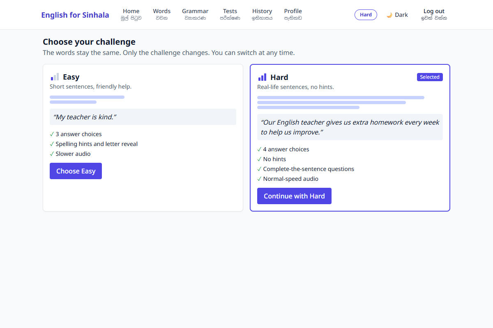 |

| Picture words | Phone tab bar |
| --- | --- |
| 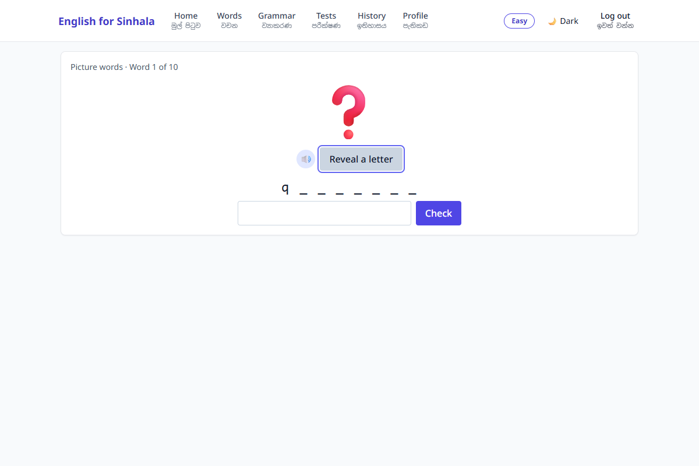 | 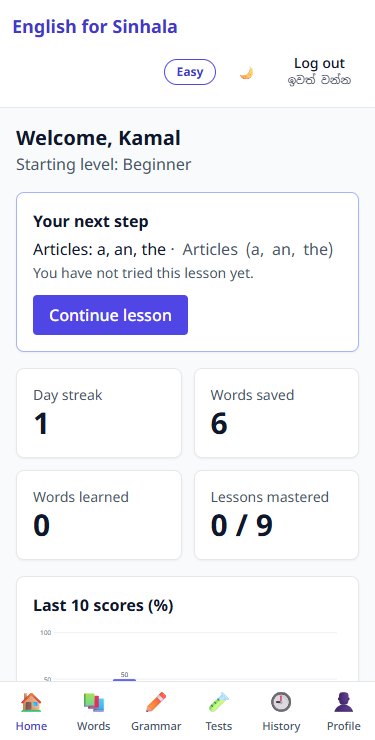 |

| Dark theme | 360 px mobile |
| --- | --- |
| 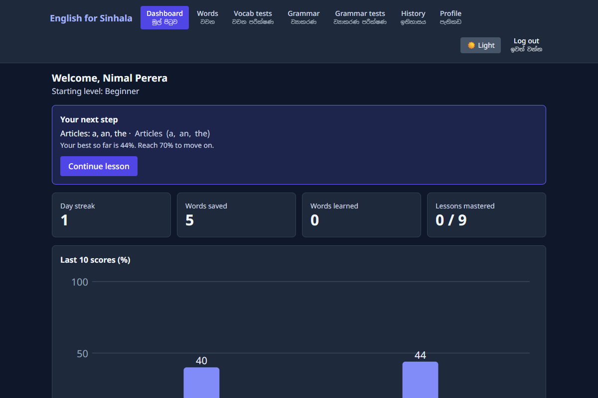 | 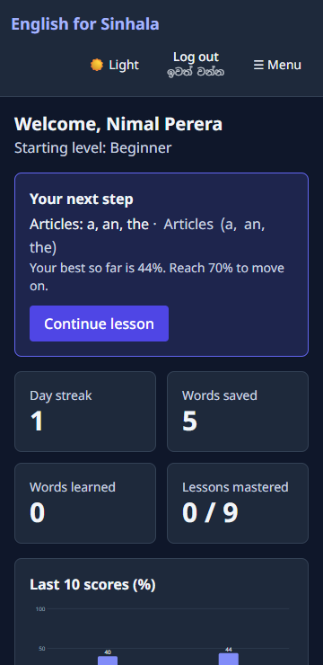 |

## Tech stack

| Part | Technology |
| --- | --- |
| Client | React 18, Vite, TypeScript, React Router, Tailwind CSS, Noto Sans + Noto Sans Sinhala |
| Server | Node.js, Express, TypeScript, zod validation |
| Database | MongoDB with Mongoose |
| Auth | JWT access token, bcrypt password hashing (`bcryptjs`) |
| Tests | Vitest + React Testing Library (client), Jest + Supertest + mongodb-memory-server (server) |

## Getting started

Requirements: Node.js 20+ and a running MongoDB (local, Docker, or Atlas).

```bash
git clone https://github.com/PraveenSanjaya/ai-education-platform.git
cd ai-education-platform
cp .env.example .env          # then edit the values (see below)
npm install
npm run seed -w server        # dictionary (240+ words), 9 lessons, admin account
npm run dev                   # client http://localhost:5173, API http://localhost:4000
```

The server also seeds the dictionary and lessons automatically on first start if they are empty.

### Scripts

| Command | What it does |
| --- | --- |
| `npm run dev` | Starts the API and the client together |
| `npm test` | Runs the server (Jest) and client (Vitest) tests |
| `npm run lint` | ESLint for the whole repo |
| `npm run format` | Prettier |
| `npm run build` | Type-checks and builds server and client |
| `npm run seed -w server` | Seeds the dictionary, lessons and the admin account |

The first server test run downloads a MongoDB binary (about 600 MB) for `mongodb-memory-server`; later runs use the cache.

## Environment variables

Copy `.env.example` to `.env` in the repo root. Secrets stay on the server; the client never sees them.

| Variable | Default | Purpose |
| --- | --- | --- |
| `PORT` | `4000` | API port |
| `MONGODB_URI` | `mongodb://127.0.0.1:27017/ai-education-platform` | MongoDB connection string |
| `JWT_SECRET` | dev value | **Set a long random string in production** |
| `JWT_EXPIRES_IN` | `7d` | Access token lifetime |
| `CLIENT_ORIGIN` | `http://localhost:5173` | Allowed CORS origin |
| `GOOGLE_TRANSLATE_API_KEY` | empty | Optional. Google Cloud Translation (target `si`), used only for words missing from the dictionary. Results are cached in the dictionary. |
| `ADMIN_EMAIL`, `ADMIN_PASSWORD` | none | Used by the seed script to create the admin account |

Without a translation key the app still works: unknown words simply ask the learner to type the Sinhala meaning.

## How it works

### Vocabulary
- Typing an English word calls `GET /api/dictionary/lookup?word=` (debounced 300 ms). Simple forms are handled (`learns → learn`, `studies → study`, `running → run`). The learner can always edit the Sinhala field.
- Tests (10 questions): English → Sinhala, Sinhala → English, Spelling, and Mistakes review (only words marked `needsReview`, mixed formats).
- Adaptive rule: words are picked with probability weighted by `6 − strength`. Correct: strength +1 (max 5), and `needsReview` is cleared once strength ≥ 3. Wrong: strength −2 (min 0) and `needsReview = true`.

### Challenge level (Easy / Hard)
Every dictionary word has a short `sentenceEasy` (3–5 words) and a longer real-life `sentenceHard`. The learner picks a challenge on `/challenge` (also reachable from the pill in the header); it is stored as `challenge` on the user and the words stay the same.

| | Easy | Hard |
| --- | --- | --- |
| Answer choices | 3 | 4 |
| Spelling hints and letter reveal | yes | no |
| Complete-the-sentence questions (word blanked out of `sentenceHard`) | no | yes |
| Speech rate | 0.85 | 1.0 |
| Example sentences | easy sentence | hard sentence |

### Picture words and Listen and type
`GET /api/dictionary/picture-words` returns words that have a picture (an emoji stored in `imageUrl` for 80 concrete nouns), preferring the learner's saved words. Picture words shows the picture with **Listen** and **Reveal a letter** (Easy only); Listen and type plays the word automatically with a big replay speaker and is hidden when `speechSynthesis` is unavailable. Results go to history, and saved words change strength like other vocabulary tests. Speaker buttons also appear next to saved words and lesson examples.

The home page (`/`) shows a hero, a live "Try one word" card and a stats band (`GET /api/public/stats`, `/api/public/sample`) to visitors; logged-in learners see the dashboard.

### Grammar path
Lessons are stored in the `lessons` collection, so new lessons can be added without code changes (insert a document with the same shape as `server/src/data/lessonsData.ts`).

- A lesson **unlocks** when the previous lesson's best score is ≥ 70%, or when it is at or below the learner's start level.
- Score **≥ 70%**: next lesson unlocks. **50–69%**: "Try again". **< 50%**: back to the explanation with the Sinhala notes opened.
- **Recommended lesson**: the first unlocked lesson, from the start level upward, with best < 70%.
- Question types: multiple choice, fill in the blank (several accepted answers), true/false, and tap-to-build word ordering. Every answer shows instant feedback with the right answer and a one-line explanation.
- **Mixed review**: 10 questions from unlocked lessons, weighted toward low scores.
- **Level check**: one question per lesson; counting stops at the second mistake and the furthest lesson reached sets the start level.

### History and progress
Every finished test or lesson is saved with its missed questions. The dashboard shows the daily streak (using the learner's local day), words saved, words learned (strength ≥ 4), lessons mastered, the last 10 scores, and a "next step" card.

### Accessibility and UI
Responsive down to 360 px, light/dark theme (remembered), visible keyboard focus, skip link, number keys (1–4) to answer and Enter to check/advance, bilingual navigation labels, and loading and empty states.

## API

All routes are under `/api`, JSON, and need `Authorization: Bearer <token>` except register/login/health.

| Method | Route | Description |
| --- | --- | --- |
| GET | `/health` | Health check |
| POST | `/auth/register`, `/auth/login` | Create account / log in (returns `token` and `user`) |
| GET, PUT | `/users/me` | Read / update own name, start level and challenge |
| GET, POST, PUT, DELETE | `/admin/users[/:id]` | Admin only. DELETE deactivates the user |
| GET | `/dictionary/lookup?word=` | Sinhala meaning, part of speech, example |
| GET, POST, DELETE | `/words[/:id]` | Word list (`?q=`, `?filter=all\|learning\|learned\|mistakes`), add, delete |
| GET | `/words/test?type=en-si\|si-en\|spelling\|mistakes` | Build a 10-question vocabulary test |
| GET | `/lessons`, `/lessons/:id` | Path with lock state and scores / one lesson |
| GET | `/grammar/mixed`, `/grammar/placement` | Mixed review and level check questions |
| POST | `/results` | Submit `vocab`, `grammar`, `mixed` or `placement` answers; grades, updates progress, records history |
| GET, DELETE | `/history` | History with summary / clear history |
| GET | `/progress` | Dashboard data |
| GET | `/dictionary/picture-words?count=` | Words with pictures for the picture games |
| GET | `/public/sample`, `/public/stats` | No login: 3 picture words and real counts for the home page |

Request bodies are validated with zod and errors come back as `{ "error": "message" }`.

## Project layout

```
client/   React app (pages, components, lib, context)
server/   Express API (routes, models, services = pure rules, seed, data)
docs/     Screenshots
```

Adaptive rules are pure functions in `server/src/services` (`adaptive.ts`, `grammarRules.ts`, `placement.ts`, `mixedReview.ts`, `progress.ts`) and are unit tested.

## Git workflow

`main` holds released code and `develop` is the integration branch. Each feature lives on its own `feature/<name>` branch created from `develop` and merged with `--no-ff`. Commits follow Conventional Commits with the feature as the scope, for example `feat(vocabulary): add Sinhala auto-lookup on word input`.

Challenge level and picture games were added as feature 10, after the original nine.
